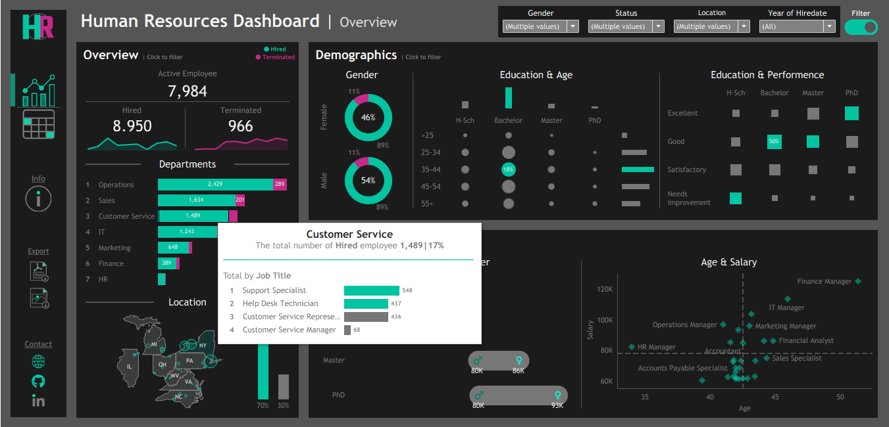
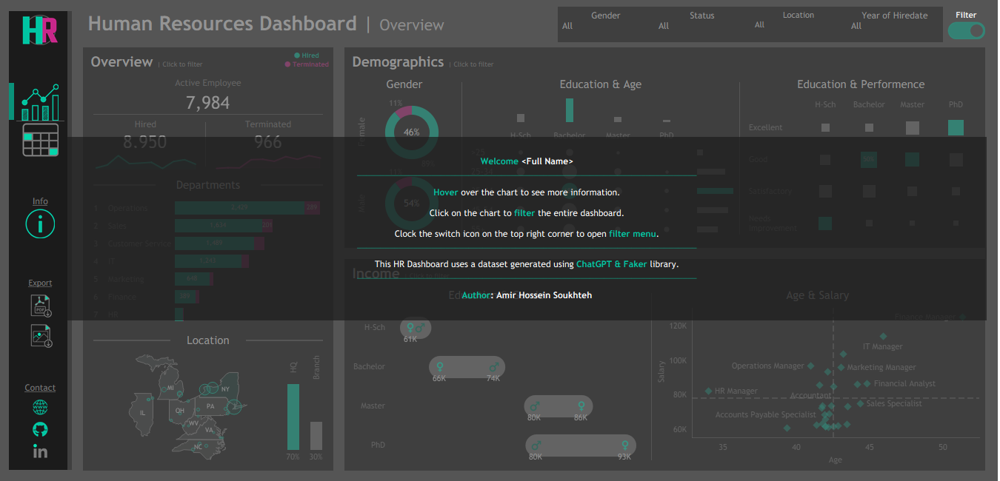

# HR Analytics Dashboard | Tableau

An interactive HR analytics dashboard built with Tableau to explore workforce demographics, hiring and termination trends, employee distribution, education, performance, and salary patterns.

## Table of Contents

- [Overview](#overview)
- [Dashboard Preview](#dashboard-preview)
- [Key Metrics](#key-metrics)
- [Dashboard Features](#dashboard-features)
- [Dataset](#dataset)
- [Tools & Technologies](#tools--technologies)
- [How to Use](#how-to-use)
- [Repository Structure](#repository-structure)
- [Acknowledgments](#acknowledgments)
- [Author](#author)

## Overview

This project presents an interactive HR dashboard designed to transform employee data into an accessible visual analytics experience.

The dashboard provides two main views: an **Overview Dashboard** for high-level workforce analysis and a **Detailed Dashboard** for employee-level exploration. Interactive filters, chart selections, and tooltips allow users to investigate workforce patterns across demographics, departments, locations, education levels, job roles, employment status, and salary.

The project emphasizes data visualization, interactive dashboard design, and the presentation of HR metrics in a format that supports workforce analysis and informed decision-making.

## Dashboard Preview

### 1. HR Overview Dashboard

The overview dashboard brings together workforce KPIs, demographic distributions, department-level employee counts, geographic information, education and performance comparisons, and salary analysis.


### 2. HR Detailed Dashboard

The detailed dashboard provides an employee-level table containing information such as demographics, job roles, geographic location, salary, employment status, and length of employment.

The table also uses visual indicators to make employment status and tenure easier to interpret.


### 3. Interactive Filters

The dashboard includes filters for employee ID, name, gender, age group, education level, department, job title, location, salary, employment status, hire date, termination date, and length of employment.

These controls allow users to narrow the dataset and investigate specific workforce segments.


### 4. Interactive Tooltips

Hovering over visualizations reveals additional information. For example, the department chart provides further details about employee counts and job-title distributions.



### 5. Dashboard Information

The information panel introduces the dashboard and explains how to interact with its visualizations, including hovering over charts, selecting data points, and accessing filters.

It also identifies the dataset as synthetically generated using ChatGPT and the Faker library.



## Key Metrics

The overview dashboard displays the following headline workforce figures:

| Metric | Value |
|---|---:|
| Active Employees | 7,984 |
| Total Hired | 8,950 |
| Total Terminated | 966 |

These figures are the values displayed in the current dashboard and may change when filters are applied.

## Dashboard Features

### Workforce Overview

- Active employee, hiring, and termination KPIs.
- Hiring and termination trend visualizations.
- Employee distribution across departments.

### Demographic Analysis

- Gender distribution.
- Education levels and age-group comparisons.
- Geographic distribution of employees.
- Education and performance comparisons.

### Income Analysis

- Salary comparisons across education levels and gender.
- Age and salary relationships.
- Salary distribution across job roles.

### Employee-Level Exploration

- Detailed employee records.
- Employment status and tenure indicators.
- Filters across demographic, professional, geographic, and employment-related attributes.

### Interactive Visualization

- Chart selection to filter dashboard views.
- Tooltips for additional analytical context.
- Filter controls for customized exploration.

## Dataset

The project uses `HR.csv`, located in the `Dataset/` directory.

The dataset contains synthetic HR-related employee information used to build the dashboard. According to the dashboard's information panel, the data was generated using ChatGPT and the Faker library rather than representing verified records from a real organization.

## Tools & Technologies

- **Tableau:** Dashboard development and interactive visualization.
- **CSV:** Source data format.
- **Tableau Packaged Workbook (`.twbx`):** Shareable workbook containing the dashboard and supporting resources.

## How to Use

1. Clone or download this repository.
2. Open `HR Dashboard.twbx` in Tableau Desktop.
3. Navigate between the Overview and Details views.
4. Apply filters to focus on particular workforce segments.
5. Select charts or hover over data points to explore additional information.

## Repository Structure

```text
HR Dashboard/
├── Dataset/
│   └── HR.csv
├── pics/
│   ├── HR  Summary.png
│   ├── HR  Detailed.png
│   ├── HR  Detailed filters.png
│   ├── HR-info.png
│   └── HR-tooltip.PNG
├── HR Dashboard.twbx
└── readme.md
```

## Acknowledgments

Special thanks to the creators of the educational resources and tools that supported the development of this project.

The HR dataset was synthetically generated using ChatGPT and the Faker library.

## Author

**Amir Hossein Soukhteh**

- **GitHub:** [@AmirHSoukhteh](https://github.com/AmirHSoukhteh)
- **Portfolio:** [amirhsoukhteh.github.io](https://amirhsoukhteh.github.io)
