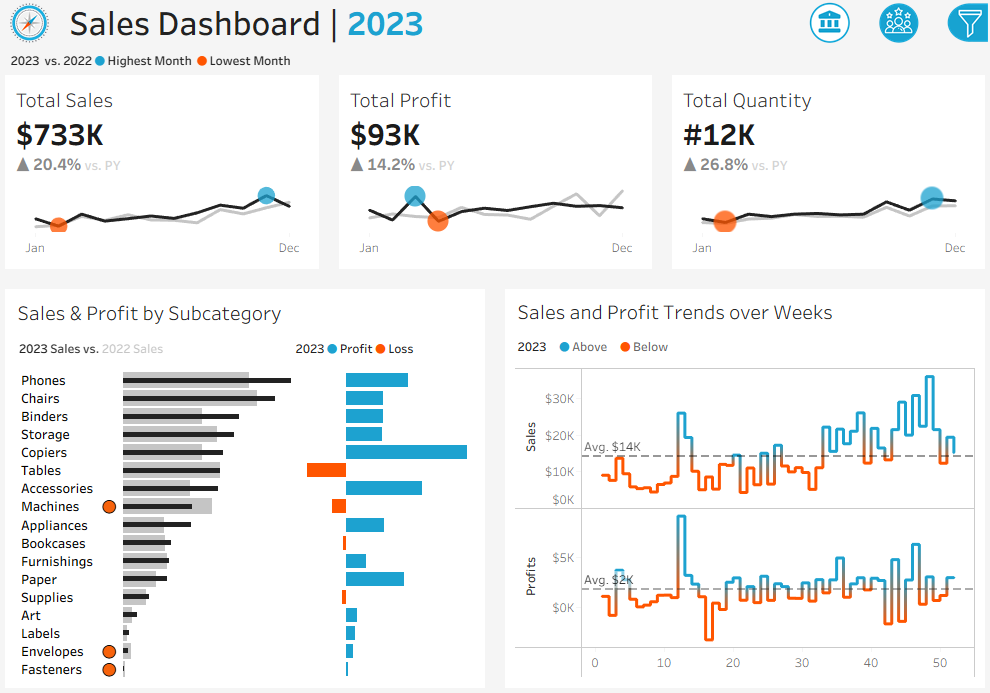
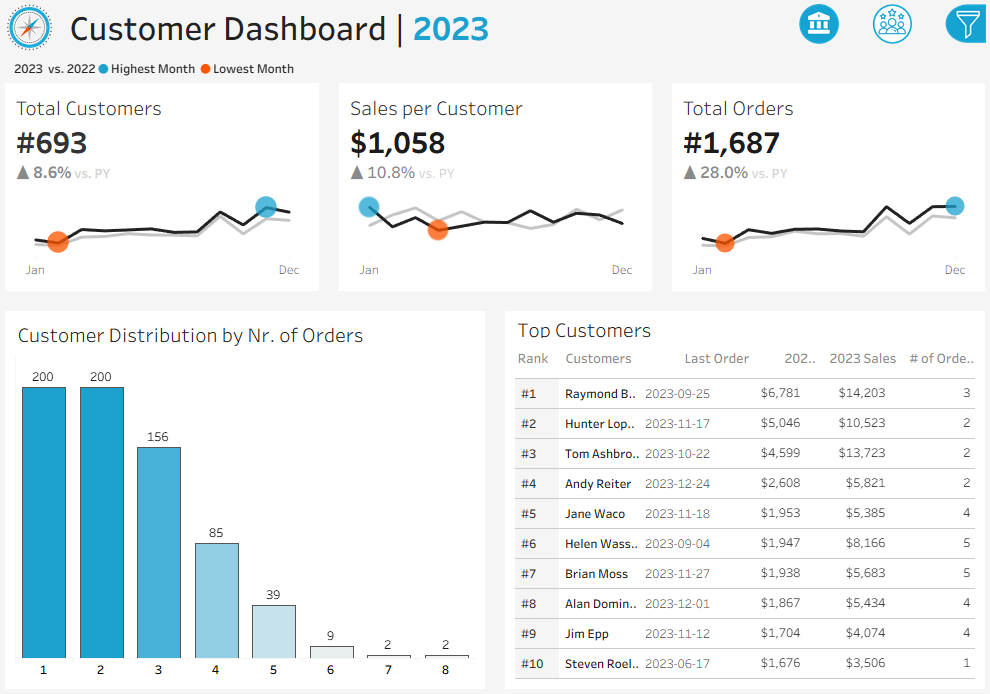
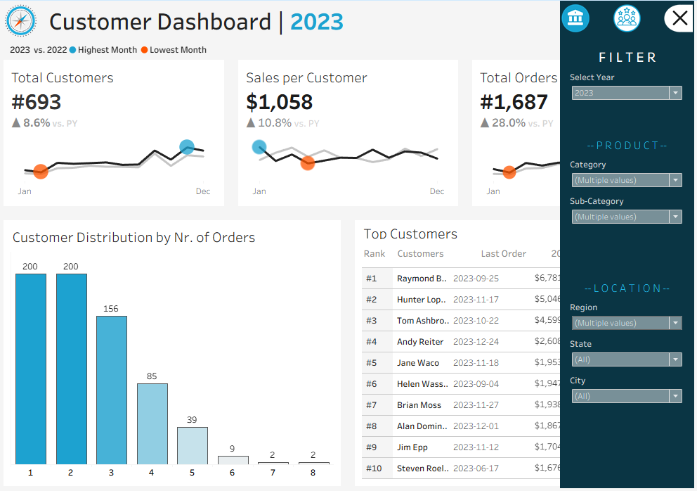
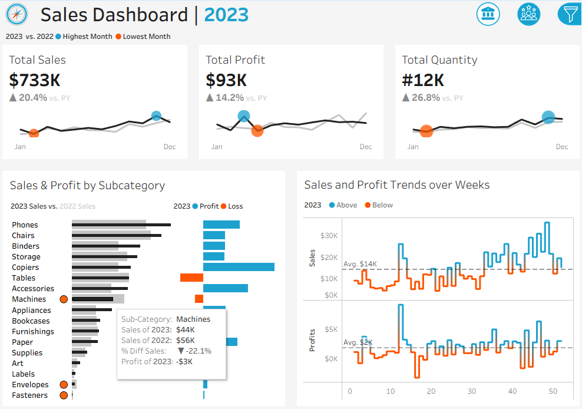

# Sales & Customer Analytics Dashboard | Tableau

An interactive Tableau dashboard for analyzing sales performance, profitability, product subcategories, and customer purchasing behavior, with year-over-year comparisons for 2020, 2021, 2022 and 2023.

## Table of Contents

- [Overview](#overview)
- [Dashboard Preview](#dashboard-preview)
  - [Sales Dashboard](#1-sales-dashboard)
  - [Customer Dashboard](#2-customer-dashboard)
  - [Interactive Filters](#3-interactive-filters)
  - [Interactive Tooltips](#4-interactive-tooltips)
- [Key Metrics](#key-metrics)
- [Business Questions](#business-questions)
- [Dashboard Features](#dashboard-features)
- [Dataset](#dataset)
- [Tools & Technologies](#tools--technologies)
- [How to Use](#how-to-use)
- [Repository Structure](#repository-structure)
- [Author](#author)

## Overview

This project uses Tableau to transform sales and customer data into interactive dashboards for business performance analysis.

The dashboard consists of two complementary views. The **Sales Dashboard** focuses on revenue, profit, quantity sold, product subcategory performance, and weekly trends. The **Customer Dashboard** explores customer counts, sales per customer, order frequency, and top-performing customers.

Both dashboards include year-over-year comparisons and interactive filters, allowing users to investigate performance across product categories and geographic locations.

## Dashboard Preview

### 1. Sales Dashboard

The Sales Dashboard provides an overview of business performance in 2023, comparing key metrics with the previous year.

It combines headline KPIs, monthly trends, product subcategory comparisons, and weekly sales and profit analysis.



### 2. Customer Dashboard

The Customer Dashboard focuses on customer purchasing behavior and contribution to business performance.

It includes customer count, average sales per customer, total orders, order-frequency distribution, and a ranked table of top customers.



### 3. Interactive Filters

The filter panel allows users to refine the analysis by year, product category, subcategory, and geographic location, including region, state, and city.



### 4. Interactive Tooltips

Hovering over individual visualizations reveals additional information. The example below shows subcategory-level sales comparisons and profitability, making it easier to investigate product performance without leaving the dashboard.



## Key Metrics

The following figures are displayed in the 2023 dashboard screenshots. They represent the currently displayed dashboard values and may change when filters are applied.

### Sales Dashboard

| Metric | 2023 Value | Change vs. Previous Year |
|---|---:|---:|
| Total Sales | $733K | +20.4% |
| Total Profit | $93K | +14.2% |
| Total Quantity | 12K | +26.8% |

### Customer Dashboard

| Metric | 2023 Value | Change vs. Previous Year |
|---|---:|---:|
| Total Customers | 693 | +8.6% |
| Sales per Customer | $1,058 | +10.8% |
| Total Orders | 1,687 | +28.0% |

## Business Questions

This project explores several business questions through interactive visual analytics.

### Sales Performance

- How have sales, profit, and quantity changed compared with the previous year?
- Which months show the highest and lowest performance?
- How do weekly sales and profit compare with their average levels?
- Which product subcategories contribute most to overall sales?

### Product Profitability

- Which product subcategories generate the highest sales and profit?
- Which subcategories experience losses?
- Are high-sales subcategories also the most profitable?
- Which products or categories may require further investigation?

### Customer Behavior

- How many customers and orders does the business have?
- How much sales revenue does each customer generate on average?
- How is the customer base distributed by order frequency?
- Which customers contribute most to sales?
- How do customer metrics change compared with the previous year?

## Dashboard Features

- **KPI Cards:** Highlight sales, profit, quantity, customer count, sales per customer, and orders.
- **Year-over-Year Comparison:** Compare 2023 performance with the previous year.
- **Monthly Trend Analysis:** Identify high- and low-performing months.
- **Weekly Sales and Profit Analysis:** Compare weekly results with average performance.
- **Subcategory Analysis:** Compare current and previous-year sales alongside profit and loss.
- **Customer Segmentation:** Explore customers based on their number of orders.
- **Top Customer Ranking:** Review leading customers, last order dates, sales, and order counts.
- **Interactive Filters:** Refine results by year, category, subcategory, region, state, and city.
- **Interactive Tooltips:** Access additional context and detailed metrics within visualizations.

## 📊 Dataset

The project includes four CSV files containing the data used for the sales and customer dashboards:

- **Customers.csv** — Customer-related information.
- **Location.csv** — Geographic information for regional and location-based analysis.
- **Orders.csv** — Order-level data used to analyze sales, profit, quantity, and customer activity.
- **Products.csv** — Product information for category and subcategory analysis.

The Tableau workbook is provided as a packaged `.twbx` file, making it easier to open and explore the dashboards in Tableau.

## Tools & Technologies

- **Tableau:** Interactive dashboards and data visualization
- **Data Analytics:** Sales performance analysis, customer analysis, and year-over-year comparisons
- **Business Intelligence:** KPI reporting, trend analysis, and profitability analysis

## How to Use

1. Clone or download the repository.
2. Open the Tableau workbook in Tableau Desktop.
3. Navigate between the Sales and Customer dashboards.
4. Select the desired year and apply product or geographic filters.
5. Hover over charts and data points to explore detailed metrics.
6. Compare the displayed results to identify trends and performance differences.

## 📁 Repository Structure

```text
Sales Dashboard/
│
├── Dataset/
│   ├── Customers.csv
│   ├── Location.csv
│   ├── Orders.csv
│   └── Products.csv
│
├── pics/
│   ├── customers_dashboard.PNG
│   ├── sales_customer_filters.PNG
│   ├── sales.PNG
│   └── tooltip.PNG
│
├── Tableau Project Sales & Customers.twbx
└── readme.md
```


## Author

**Amir Hossein Soukhteh**

- **GitHub:** [@AmirHSoukhteh](https://github.com/AmirHSoukhteh)
- **Portfolio:** [amirhsoukhteh.github.io](https://amirhsoukhteh.github.io)
